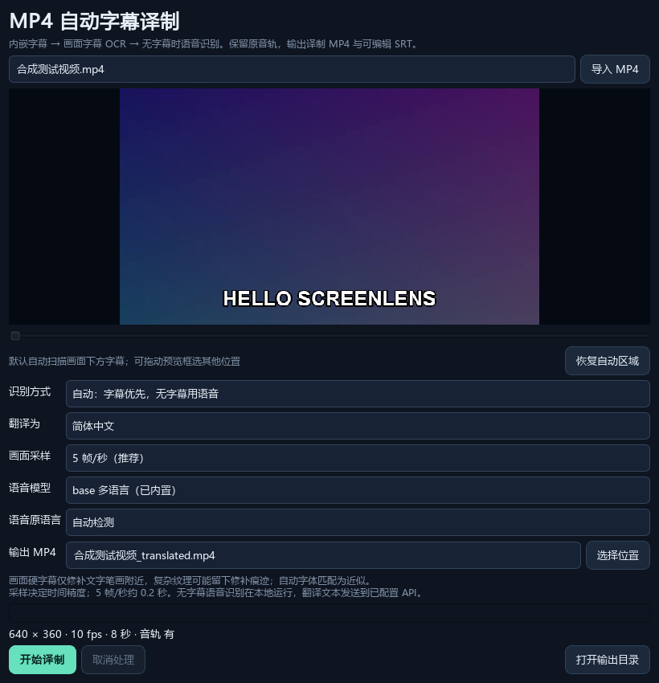
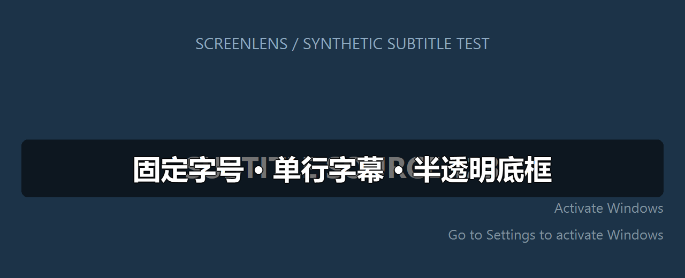

# 视译 ScreenLens 2.0.2

Windows 屏幕字幕翻译与 MP4 译制软件。实时字幕默认固定字号、单行分段显示、半透明底框，保留后方原字幕；视频模式支持内嵌字幕、硬字幕 OCR、无字幕时本地语音识别。

ScreenLens is a Windows screen-region translator with fixed-size, single-line subtitle pages and a translucent background, plus MP4 translation with local OCR and speech-recognition fallback.

本仓库以 **GPL-3.0-or-later** 发布 ScreenLens 原创源码。第三方组件保留其各自许可证。源码版本见 [Releases](https://github.com/VGCLUB/ScreenLens/releases)，构建步骤见下文。



*界面和效果预览使用合成素材，译文由本地模拟接口返回。*



## 使用

源码运行请使用下文“开发”步骤。构建 Windows 目录式发行包后，退出旧版，运行 `dist/2.0.2/ScreenLens/ScreenLens.exe` 并保留整个目录。完整构建包含视频工具与 base 模型。旧版 API 配置保留，实时显示配置自动迁移为半透明单行字幕。

屏幕翻译：设置 API，Alt+Q 框选字幕区域。Alt+W 暂停，Alt+S 重译，Alt+T 显示/隐藏。字幕始终一行，字体和字号只由设置决定，默认 26 px，底框默认不透明度 55%。底框只占一条字幕高度，不修补原字幕或背景。框选过矮时仅扩展显示层，识别区域保持原位。

长译文按单行分段切换，包含换行的译文会先合并成一行；不会缩小字体或变成多行。每段按长度和最短阅读时间停留，显示完后停在最后一段，不循环滚动。新字幕翻译完成时优先切换，避免堆积延迟；完整译文始终可在主窗口查看。

默认只选主字幕块，过滤中英文 Windows 激活水印；在“额外忽略文字”中可每行添加一条台标、游戏提示等固定干扰文字。窗口持续显示流式译文，覆盖层在整句完成后一次替换，等待下一句时保留上句。漏识别容忍默认 800 ms，整句完成后最短阅读 1200 ms；原文消失时给剩余分段留出阅读时间。最短阅读设为 0 可立即跟随原文消失。实时 OCR 和 API 延迟无法消除。设置中保留旧版局部修复及透明文字显示方式。

视频翻译：点击“导入 MP4”，选择目标语言和输出。自动模式先提取内嵌字幕，再扫描下方硬字幕，没有字幕时转语音识别。其他字幕位置可手动框选。已知没有字幕，可直接选择语音识别跳过 OCR。内置 base 多语言模型，small 可选但首次需下载。采样 2/5/10 fps，默认约 0.2 秒粒度。

输出译制 MP4、翻译/原文 SRT、项目 JSON。原视频不覆盖，重名自动编号。视频重新编码 H.264，原声编码 AAC，按输入标称帧率输出固定帧率。项目包含本地输入路径、字幕和样式，不含 API Key。

## 实现

- `ocr.py`：RapidOCR / PP-OCRv6 本地识别，输出文字与坐标。
- `appearance.py`：估计颜色、字号、描边，匹配候选 Windows 字体，按字形局部 inpaint 与译文渲染。
- `tracking.py`：文字相似性、连续变化确认与漏识别容忍。
- `live.py`：水印与自定义文字过滤、主字幕位置筛选；旧显示方式的样式锁定。
- `line_layout.py`：Qt Unicode 分段与单行排版，固定字号、完整分页、按长度计算阅读时间。
- `pipeline.py`：捕获、OCR、翻译独立线程，单帧邮箱与最新翻译任务；原文间隙允许已请求的译文完成，新字幕取消旧请求。
- `subtitle.py`：鼠标穿透、不抢焦点、捕获排除，按翻译完成时间保留最短阅读时间。
- `translation.py`：SSE、错误处理、缓存、字幕批量翻译、ID 校验与逐句回退。
- `media.py` / `video.py`：轨道解析、统一时间基准、字幕识别/语音回退、样式、局部擦字、音轨与成片导出。
- `video_ui.py`：导入、预览、框选、语言、模型、进度、取消与输出。
- `selfcheck.py` / `video_selfcheck.py`：软件自有合成窗口和视频的原生及端到端检查。

截图、视频、音频不上传，只有识别文本发往配置的 API。OCR 和语音在本地 CPU 运行。API Key 通过 Windows DPAPI 存储。屏幕译文不保存历史；视频显式保存输出。额外 OCR 语种和 small 语音模型首次会下载。

## 开发

需要 Windows 10/11 x64、Python 3.12 和 [uv](https://docs.astral.sh/uv/)。视频功能需先在 PATH 中准备 FFmpeg / FFprobe，也可将它们放在 `assets/ffmpeg`。Windows 可参考 [FFmpeg 上游下载页](https://ffmpeg.org/download.html) 的构建资源。字体匹配依赖本机 Windows 字体。

```powershell
git clone https://github.com/VGCLUB/ScreenLens.git
cd ScreenLens
uv venv --python 3.12 .venv
uv pip install --python .venv\Scripts\python.exe -r requirements.txt
.venv\Scripts\python.exe prepare_video_assets.py
.venv\Scripts\python.exe run.py
.venv\Scripts\python.exe -m pytest -q --junitxml=qa\test-results.xml
.venv\Scripts\python.exe qa\create_video_fixtures.py
powershell -ExecutionPolicy Bypass -File .\build.ps1 -NativeOverlayCheck -VideoCheck
.venv\Scripts\python.exe package_release.py
```

源码包不重复包含大型视频二进制和语音权重。开发者需将 FFmpeg 放在 PATH 或 `assets/ffmpeg`；准备脚本复制本机 FFmpeg 并下载免费 base 权重。完整免安装包已内置这些组件。CPU int8 推理，无需 GPU。

## 验证与边界

63 项测试覆盖密钥、HTTP/SSE、取消、缓存、批量 ID、字形与透明背景、漏检、阅读时间、水印干扰、字号锁定、单行分页、多语言与 emoji、半透明固定底框、原图不被修补、旧配置迁移、整句更新、慢 OCR 下持续捕获、SRT、文件保护与对话框退出。原生覆盖检查真实识别合成字幕与激活水印，验证过滤、不同句长字号恒定、真实计时分页、55% 底框及捕获排除。源码和发行包实际处理三条合成视频路径，检查 OCR、语音、成片、音轨和时长。翻译接口为本机模拟服务，没有使用用户真实 Key，不能据此证明云端翻译质量和网络速度。

硬字幕字体及被遮挡背景无法从像素精确复原。自动匹配与主字幕筛选是近似；框选尽量只包含字幕，位置变化较大时需重新框选。与字幕重叠的水印、复杂纹理、动画、竖排、花字和小字可能有识别或局部修补误差。base 语音模型速度优先。视频默认 OCR 仅扫描下方，其他位置需框选。采样间隔内的极短字幕可能遗漏。内嵌字幕复用可导出的基础样式，逐字特效和复杂定位不保证保留。

Windows 10/11 x64，原位覆盖需 Windows 10 2004 以上桌面合成正常。每次屏幕框选限同一显示器；控制窗口应移开或最小化。受保护内容可能无法捕获。

## 开源许可

Copyright (C) 2026 VGCLUB and ScreenLens contributors。

ScreenLens 原创代码采用 [GPL-3.0-or-later](LICENSE)。第三方库、模型、字体和视频工具不因本项目开源而改变许可证。仓库不包含 API Key、用户配置、私人媒体、FFmpeg 可执行文件或大型语音权重。完整二进制发行时应同时满足所包含组件的源码与许可分发要求。

许可、构建与对应源码链接在 `licenses/`，见 `THIRD_PARTY_NOTICES.md`。

## 上游

- [RapidOCR](https://github.com/RapidAI/RapidOCR)
- [DeepSeek](https://api-docs.deepseek.com/api/create-chat-completion/)
- [faster-whisper](https://github.com/SYSTRAN/faster-whisper)
- [base 模型](https://huggingface.co/Systran/faster-whisper-base)
- [FFmpeg](https://ffmpeg.org/ffmpeg.html)
- [Windows 捕获排除](https://learn.microsoft.com/en-us/windows/win32/api/winuser/nf-winuser-setwindowdisplayaffinity)
